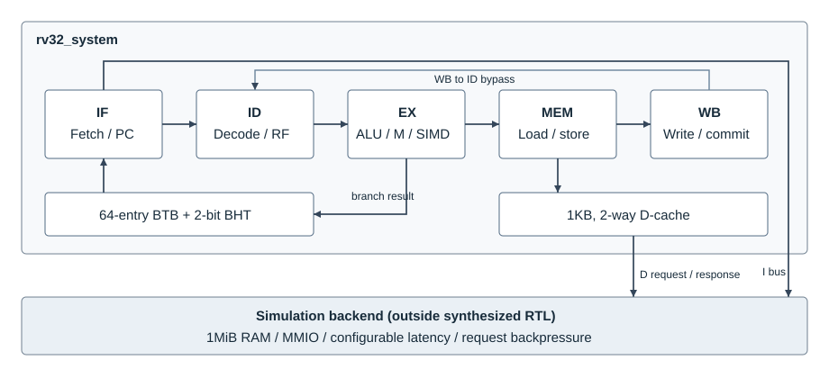
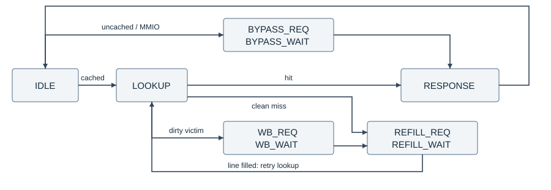

# 五级 RISC-V 处理器与定长 SIMD 扩展设计报告

项目：riscv-cpu-lab

实现语言：SystemVerilog、C/C++、Python

记录日期：2026 年 10 月 16 日

## 1. 项目概述

### 1.1 设计任务

设计一个能执行 RV32IM 裸机程序的五级流水线处理器，并在同一核心上比较标量程序与定长 SIMD 程序的执行周期。基础配置参考已有 CPU 设计报告中的五级流水线、1KB 两路数据缓存及 64 项分支预测器；代码按本工程的总线和测试接口重新实现，没有接入原报告中的外设桥或孪生平台。

本次扩展集中在整数数据通路：将一个 32 位寄存器中的四个字节作为四路数据，增加逐字节加法、逐半字加法和有符号字节点积。这样无需增加向量寄存器文件，就能在现有译码、前递和提交路径上测试并行数据运算的收益。

### 1.2 设计目标与实现范围

| 项目 | 本工程实现 |
| --- | --- |
| 基础指令 | 37 条 RV32I 计算、访存与控制指令，另实现 FENCE、ECALL、EBREAK |
| 乘除扩展 | MUL、MULH、MULHSU、MULHU、DIV、DIVU、REM、REMU |
| 流水线 | 五级、单发射、顺序执行与提交 |
| 冒险处理 | MEM/WB 前递、WB 到 ID 旁路、load-use 停顿、分支冲刷 |
| 数据缓存 | 1KB、两路组相联、LRU、写回、写分配 |
| 分支预测 | 64 项带标签 BTB 和两位饱和计数器 |
| 自定义指令 | xadd8、xadd16、xdot8 |
| 功能验证 | 四态模块仿真、Verilator 执行、Spike 差分和 RAM 比较 |
| 系统软件 | 裸机启动、链接脚本、SIMD C 内联函数和三个计算内核 |

当前没有完整特权架构、CSR、中断、MMU、操作系统和标准 RVV。异常到达提交阶段后，核心报告原因并停机。这里的 RV32IM 表示已实现的整数计算与乘除能力，不表示通过了完整的 RISC-V 架构合规认证。

### 1.3 开发与测试环境

开发机为 Windows 11，仿真和编译运行于 Ubuntu 24.04 WSL2。RTL 周期仿真使用 Verilator 5.020，四态模块测试使用 Icarus Verilog 12.0，交叉编译器为 GCC 13.2.0。Spike 固定到提交 `f8a060b7bea8da6f738f193ed1b66b665978d092`。

Vivado 2026.1 用于独立综合。当前安装了 `xc7a35tcsg324-1` 的器件支持，因此使用该器件检查综合输出；它不是已经选定的开发板。原参考报告中的 `xc7k325tffg900-2` 不在本机已安装的器件列表中。

## 2. RISC-V CPU 基础架构设计

### 2.1 指令集与执行环境

通用寄存器为 32 个 32 位寄存器，x0 恒为零。指令定长 32 位，不支持压缩指令。复位 PC 为 `0x80000000`，程序和数据采用小端字节序。

| 类别 | 指令 |
| --- | --- |
| 寄存器算术与逻辑 | ADD、SUB、SLL、SLT、SLTU、XOR、SRL、SRA、OR、AND |
| 立即数算术与逻辑 | ADDI、SLTI、SLTIU、XORI、ORI、ANDI、SLLI、SRLI、SRAI |
| 加载与存储 | LB、LH、LW、LBU、LHU、SB、SH、SW |
| 条件分支 | BEQ、BNE、BLT、BGE、BLTU、BGEU |
| 跳转与高位立即数 | JAL、JALR、LUI、AUIPC |
| 存储排序与环境指令 | FENCE、ECALL、EBREAK |

JALR 先计算寄存器与立即数之和，再清除最低位。若实际跳转地址仍未按 4 字节对齐，则报告指令地址未对齐异常。半字和字访问同样检查对齐，不拆分成多次非对齐访存。

### 2.2 整体结构与存储接口

顶层 `rv32_system` 实例化 `rv32_core` 和 `rv32_dcache`。核心内部包含译码、ALU、乘除运算、SIMD 和分支预测模块。数据缓存位于核心数据端口与后端之间；指令端口直接连接取指后端，没有指令缓存。

图 2-1 处理器与仿真后端。实线表示请求和数据连接，预测器向 IF 提供下一 PC，EX 返回分支结果。仿真 RAM 不属于待综合的处理器顶层。

I/D 接口分别设置请求与响应通道。请求在 valid、ready 同时为 1 的时钟沿被接受；每通道最多保留一笔未完成事务。响应最早出现在下一周期，接收方未就绪时，发送方保持响应数据、错误位和 valid 不变。

数据端口按 32 位字对齐，使用四位字节使能选择实际写入字节。字节使能为零表示读请求。接口不是 AXI，当前没有突发传输和多个事务编号。仿真中 I/D 共用 1MiB RAM，但不模拟共享总线仲裁。

| 地址 | 仿真环境用途 |
| --- | --- |
| 0x80000000 至 0x800FFFFF | 1MiB RAM，可缓存 |
| 0x10000000 | 字符输出，写最低字节 |
| 0x10000004 | 仿真 GPIO，读返回零，写入次数用于检查错误路径副作用 |
| 其他地址 | 返回访问错误 |

### 2.3 五级流水线

| 阶段 | 保存的主要信息 | 完成条件 |
| --- | --- | --- |
| IF | 请求 PC、预测下一 PC、在途状态 | 后端返回且 ID 可接收 |
| ID | 指令、PC、预测值、取指错误 | EX 可接收且不存在 load-use 冲突 |
| EX | 操作数、立即数、控制信号、目的寄存器 | 运算完成且 MEM 可接收 |
| MEM | 运算结果、访存地址、存储数据、异常信息 | 普通运算直接通过；访存或 FENCE 等待响应 |
| WB | 写回值、下一 PC、访存与异常记录 | 更新寄存器并输出提交记录 |

各级使用有效位区分指令与气泡。后级等待时，前级保留尚未交出的指令；组合逻辑根据保存的数据形成结果，在有效交接的时钟沿更新状态。不同指令可重叠执行；缓存未命中、迭代除法和取指等待会降低提交速率。

### 2.4 各流水级实现

#### 2.4.1 IF：取指与在途请求

`fetch_pc` 保存下一次请求地址，`pending` 表示已接受但尚未返回的请求。发出取指时一并保存该指令的预测下一 PC，后续由 EX 比较实际结果。

重定向时不能假定后端会取消已经接受的请求。因此，核心用 `pending_killed` 标记旧路径响应：响应回来后完成握手，但不再写入 ID。尚未被后端接受的请求可以直接撤销。

#### 2.4.2 ID：译码与寄存器读取

`rv32_decode` 提取 rs1、rs2、rd 和立即数，生成 ALU、分支、访存、M 扩展和 SIMD 控制信号。I、S、B、U、J 类型立即数分别拼接并扩展。

寄存器文件采用组合读取、时钟沿写入。WB 与 ID 同时访问同一个寄存器时，ID 优先取 WB 的写回值，避免同沿读写读到旧值。译码还标出当前指令是否真正使用 rs1、rs2，避免把立即数字段误判成寄存器依赖。

#### 2.4.3 EX：运算、跳转与地址计算

执行级先选择前递后的源操作数，再根据控制信号选择寄存器值、PC、零或立即数。ALU 执行加减、移位、比较及位运算；加载、存储地址由基址寄存器与立即数相加得到。

条件分支在 EX 比较操作数。JAL、JALR 的写回值为当前 PC 加 4。实际下一 PC 与随指令保存的预测值不同，即产生重定向，不仅检查“跳或不跳”，也检查预测目标是否正确。

乘法使用组合数据通路。除法启动后保持 EX 占用，直到结果完成；若 MEM 尚未接收，核心保存除法结果，避免丢失仅持续一个周期的 done 信号。

#### 2.4.4 MEM：访存与字节处理

MEM 用 `m_sent` 记录请求是否已被接受。后端等待期间不重复发出同一请求。存储数据按地址低两位移位，再生成 SB、SH、SW 对应的字节使能。

加载返回一个对齐字后，先选择所需字节或半字，再按 LB、LH、LBU、LHU 的要求进行符号扩展或零扩展。LW 直接使用整个返回字。FENCE 通过单独接口要求缓存扫描并写回脏行。

#### 2.4.5 WB：写回与提交记录

WB 更新非零目的寄存器，同时输出 `commit_pc`、`commit_insn`、`commit_data`、`commit_next_pc` 和访存记录。发生异常的指令不写目的寄存器，也不产生正常存储提交。

提交记录供仿真比较使用，不是调试模块或特权 CSR。64 位周期、退休指令和停顿计数器也通过顶层端口观察，程序不能通过 CSR 指令读取它们。

### 2.5 主要控制信号

| 信号 | 作用 |
| --- | --- |
| id_fire | ID 中的有效指令在本拍交给 EX |
| ex_fire | EX 运算完成且 MEM 可接收，允许向后交接 |
| m_done / m_fire | MEM 事务完成 / MEM 中有效指令实际交接 |
| load_hazard | EX 的加载目的寄存器与 ID 所用源寄存器冲突 |
| div_operands_ready | 除法所依赖的 MEM 加载结果已经可用 |
| redirect / flush_front | 纠正预测 / 清除前端旧指令 |
| mem_error / wb_trap | MEM 事务错误 / 异常到达 WB |

交接信号同时受有效位、后级接收条件和异常条件限制。仅有运算结果并不足以更新流水寄存器或训练预测器。

## 3. 流水线性能优化设计

### 3.1 结构冒险

取指与数据访问采用独立接口，仿真中不存在两者竞争同一个端口的问题。数据缓存仍是阻塞式结构，一次只能处理一个访问。未命中填充或脏行写回期间，等待沿 MEM、EX、ID 向前传播。

除法器也只接受一笔运算。本设计没有发射队列和乱序调度，后续指令不能绕过正在执行的除法。保留这种顺序结构可使异常与存储副作用的次序更明确，代价是长延迟运算直接影响吞吐率。

### 3.2 数据冒险与前递

EX 的两个源操作数分别检查 WB 和 MEM 的目的寄存器。若两级都将写入同一寄存器，MEM 中的指令在程序顺序上更近，因此优先选 MEM。x0、无写回的指令和异常指令不参与前递。

例如，连续执行 `addi x5,x0,1`、`addi x5,x5,2`、`add x6,x5,x0` 时，最后一条指令应取得较新的 x5 值 3，不能被更早的值 1 覆盖。

若 ID 依赖 EX 中加载指令的结果，`load_hazard` 阻止它进入 EX。进入 MEM 后，加载仍可能因缓存等待而停顿；只有响应完成且无错误时，才允许前递加载值。

EX 阻塞时还会保存已经获得的前递值。如果生产者离开 WB，而消费者仍在等待 MEM 或除法完成，保存的值保证操作数不会退回寄存器文件中的旧值。

### 3.3 控制冒险与异常优先级

分支预测错误由 EX 修正。ID 中的旧路径指令被清除，已经发出的旧取指响应被标记丢弃。测试中特意在错误路径上安排存储、MMIO 写和异常指令，以检查冲刷是否阻止了副作用。

MEM 错误和已经到达 WB 的异常优先于年轻指令的执行。核心取消年轻指令，保留先前已提交的结果。缓存脏行写回错误需要单独解释：失败前可能已有部分字写入后端，这些写入不能回滚，当前系统不具备完整的总线故障恢复能力。

### 3.4 时钟与吞吐率

本版本保留五级单发射结构，以便在相同微架构下比较标量和 SIMD 程序。性能测试分别记录指令数和周期数；增加流水级或双发射后的代价尚未测量。

综合使用 10ns 的试验时钟约束，综合后最差建立时间裕量为 -5.763ns，尚未满足该约束。布局布线和板级测试均未完成，没有实测主频。

## 4. 扩展模块设计

### 4.1 RV32M 乘除单元

乘法首先根据指令选择有符号或无符号扩展，再进行乘积计算。MUL 返回低 32 位，MULH、MULHSU、MULHU 分别按规定返回高 32 位。

除法采用 32 步恢复余数算法。启动时锁存操作数；普通运算每步移入被除数的一位，将部分余数与除数比较，决定商的当前位。带符号运算先求绝对值，结束后恢复商、余数的符号，余数符号与被除数一致。

除零和有符号溢出不产生算术异常。除数为零时，商为 `0xFFFFFFFF`，余数为原被除数；`0x80000000 / 0xFFFFFFFF` 的商为 `0x80000000`，余数为零。模块测试覆盖这些边界。

### 4.2 L1 数据缓存

#### 4.2.1 地址划分与存储阵列

数据阵列为 16 组 × 2 路 × 8 个 32 位字，共 1KB。地址的 31:9 位为标签，8:5 位为组号，4:2 位为行内字偏移，1:0 位为字节位置。每路保存 valid、dirty 和标签；每组保存一位 LRU 状态。

复位清除标签、有效位和脏位，不清空整个数据阵列。无效行不参与命中判断，因而无需给无效数据赋初值。本次综合未推断出块 RAM 或分布式 RAM，阵列仍由触发器和选择逻辑实现；仅去掉数据复位不足以完成 RAM 推断。

#### 4.2.2 命中、替换与填充

读命中直接返回所选字。写命中按字节使能合并数据并置脏，不立即访问后端。替换先选无效路；两路都有效时选择 LRU 路。

写未命中采用写分配：必要时先写回被替换的脏行，再从后端逐字读入新行，最后重新进行命中处理和字节合并。一行有 8 个字，因此填充需要 8 次请求与响应。后端不支持 burst，也不在关键字到达后提前恢复 CPU。

图 4-1 缓存的主要状态转换。请求状态等待 ready，等待状态接收下一周期或更晚的响应；图中省略逐字循环和错误返回支路。

#### 4.2.3 FENCE、旁路与错误

FENCE 扫描全部 32 行，将脏行写回后返回完成。已缓存的干净数据继续有效，不等于清空缓存。MMIO 和 RAM 地址范围外的访问始终旁路。

填充未完成时，新标签不会被置为有效。写回失败时保留错误信息，测试还检查模块级重试；对 CPU 而言，相应访问或 FENCE 以异常结束。错误之前已经写入后端的内容不作撤销。

写回出错时，原行的 valid、dirty 和数据均保留；最后一个字成功后才清 dirty。FENCE 不是整行原子事务。缓存模块能在故障解除后重试，CPU 则报告异常后停机，没有自动恢复执行机制。

缓存使能在复位时锁存，运行中改变引脚不会切到旁路。需要保留 RAM 内容并更换模式时，必须先成功完成 FENCE，停止新请求并排空在途事务，再复位配置；复位本身不保存脏数据。

### 4.3 动态分支预测

PC 的 7:2 位索引 64 个表项，31:8 位作为标签。标签不匹配时预测顺序地址 PC 加 4，避免只凭索引使用另一条指令的目标。

每项保存目标地址、两位计数器以及是否为无条件跳转。条件分支在计数器高位为 1 时预测跳转；实际跳转使计数器递增，实际不跳转使其递减，分别在 3 和 0 饱和。新标签根据首次结果初始化为弱跳转或弱不跳转。

JAL、JALR 命中有效表项时预测保存的目标。JALR 的目标可能随寄存器变化，不能依赖计数器保证正确；EX 仍会比较完整下一 PC。预测器只在分支或跳转实际通过 EX、且无相关异常时更新。

### 4.4 定长 SIMD 指令

三条指令采用 R 型格式，opcode 为 custom-0 的 `0x0B`，funct7 为零，通过 funct3 区分操作。

| 指令 | funct3 | 数据组织 | 结果 |
| --- | --- | --- | --- |
| xadd8 | 0 | 四对 8 位数据 | 四路独立模 256 加法 |
| xadd16 | 1 | 两对 16 位数据 | 两路独立模 65536 加法 |
| xdot8 | 2 | 四对有符号 INT8 | 四个乘积相加，返回一个 INT32 |

加法各通道之间不传递进位。例如 xadd8 中的 255 加 2 得到 1，不是饱和到 255。xdot8 按补码解释每个字节，输入范围为 -128 至 127。

按低位至高位把 [1, 2, -3, 4] 与 [5, -6, 7, 8] 打包后，xdot8 的结果为 `1×5 + 2×(-6) + (-3)×7 + 4×8 = 4`。它不读取原来的 rd；跨多个数据块累加时，软件另用 ADD 合并部分点积。

`sw/include/xsimd.h` 通过 GCC 的 `.insn` 生成指令编码，无需维护编译器分支。编译参数仍为 RV32IM、ILP32。Spike 扩展用独立的 C++ 标量计算定义相同语义，供差分测试使用。

这一扩展没有向量寄存器、VL/VTYPE、掩码和向量访存，不兼容标准 V 扩展。点积可用于量化推理中的局部计算，但本工程没有模型加载、量化流程或完整推理运行时。

## 5. CPU 模块仿真与性能测试

### 5.1 测试环境与比较方法

测试由 Make 和 Python 脚本组织。Verilator 检查全部 RTL 后，Icarus 运行运算、缓存和预测器模块测试；处理器级测试将同一程序交给 RTL 和 Spike 执行。

正常提交逐条比较 PC、机器码、目的寄存器、写回值、下一 PC，以及访存地址和有效写入字节。参考执行必须到达 `test_end`，同时受超时和指令数上限限制。异常原因按本工程的执行环境检查，而不是照搬 Spike 的 M 模式异常处理。

正常访存测试结束前执行 FENCE，再根据 Spike 的存储记录形成期望内存，与 RTL 后端的整个 1MiB RAM 比较。这样能检查只看最终寄存器结果容易漏掉的错误存储。

| 测试层次 | 结果 |
| --- | --- |
| 运算模块 | 13,414 次结果比较通过 |
| 缓存模块 | 2,837 项检查通过，含替换/FENCE 的全部八个字错误位置 |
| 分支预测器 | 10 项检查通过 |
| SIMD 数学对照 | 68,683 组独立 Python 整数期望值通过 |
| 提交比较器 | 1 组合法轨迹接受，15 种损坏轨迹拒绝 |
| 处理器主回归 | 46 组配置，33,003 次正常提交与参考一致 |
| 审查补充回归 | 25 组配置，3,252 次正常提交与参考一致 |
| 冒烟程序 | 3 种响应延迟与预测开关组合，共 6 组通过 |
| 性能程序 | 3 个内核 × 2 种实现 × 2 种缓存配置 × 2 种延迟，共 24 组通过 |

这里的指令覆盖统计包含 45 条 I/M 指令、FENCE 和三条 SIMD 指令，共 49 种正常执行类型。ECALL、EBREAK 及错误编码另外作为异常测试。统计不等于代码行覆盖率、翻转覆盖率或所有微架构状态覆盖；尚未运行官方架构测试套件和形式化验证。

### 5.2 冲刷与错误路径验证

回归在条件分支之后放置本不应执行的 MMIO 写、存储和异常指令。除检查最终寄存器外，还检查后端副作用次数，确认错误路径没有被执行或提交。

同一组程序分别在缓存、预测器开启和关闭时执行，并加入确定性的请求反压与响应抖动。结果应相同，完成周期可以不同。此处验证的是控制在等待条件变化时是否仍保持程序顺序，并非固定周期的流水线截图比较。

补充回归检查初始深度为 12 的递归、同索引返回跳转和交替间接目标。JALR 目标低两位为 2 或 3 时，由 EX 为跳转指令报告异常；总线记录中没有未对齐取指请求。

### 5.3 前递与 load-use 验证

冒烟程序先计算 35 加 7，将结果存入 `scratch`，再读回并加 7。以下记录来自 `build/smoke-l1-p1.csv`，缓存和预测器开启，后端延迟为 1 周期。

| 提交周期 | PC | 指令作用 | 结果 |
| --- | --- | --- | --- |
| 8 | 0x8000000C | ADD：35 + 7 | x7 = 0x2A |
| 30 | 0x80000018 | SW：写入 scratch | 地址 0x80000074，数据 0x2A |
| 33 | 0x8000001C | LW：读回 scratch | x29 = 0x2A |
| 34 | 0x80000020 | ADD：加载结果 + 7 | x30 = 0x31 |

表中为提交周期。SW 与前一条运算之间的间隔包含缓存和握手等待，不是 ADD 的执行延迟。

一次固定种子测试发现了除法器提前采样的问题。将 x6 先设为 1，再从未命中的地址加载 0，随后立即执行 `div x15,x17,x6`。旧实现使用了旧 x6，得到 1184；正确结果应按除零规则返回 `0xFFFFFFFF`。

原因在于除法器只在启动沿锁存一次操作数。修复在 `div_start` 上增加加载就绪条件，确保相关 MEM 加载能够前递后才启动。缩小后的 `div-load-hazard` 用例与原随机种子均保留在回归中。

第二轮增加了四种除法/余数指令的加载依赖和 40 周期后端延迟。波形检查确认结果提前完成后被保存、待 MEM 就绪再释放；较老加载出错时，年轻除法与存储不得提交。这些是定向仿真证据，未作形式化证明。

### 5.4 指令数据通路与异常测试

算术测试覆盖有符号比较、符号扩展、移位、x0 写入、乘法高低位、除零及溢出。控制测试覆盖六种条件分支、JAL、JALR 的最低位清除，以及未对齐目标。

访存测试检查 SB、SH、SW 的字节使能和加载扩展。异常测试包含 ECALL、EBREAK、非法编码、未实现的 CSR/FENCE.I、未对齐访问、取指错误和数据错误。另构建 `ENABLE_SIMD=0` 的版本，确认关闭扩展后相同自定义编码触发非法指令异常。

随机回归使用固定种子 1、7、42、73、101、257、65537、20261015，失败可按相同种子重现。测试结果和逐条提交记录分别保存在 JSON、CSV 文件中。

### 5.5 缓存与分支预测验证

缓存用例针对同组冲突构造访问序列，检查优先使用无效路、LRU 替换、脏行写回和部分字节写入。`cache-lru` 集成用例的预期计数为 1 次命中、4 次未命中、3 次写回。模块测试还覆盖填充、替换写回和 FENCE 写回的错误响应。

预测器模块测试检查标签匹配、计数器饱和、目标更新、无条件跳转和关闭预测时的行为。核心级测试检查预测错误后的控制流、指令提交和内存副作用，覆盖预测表之外的冲刷路径。

### 5.6 SIMD 性能测量

点积、数组加法和矩阵向量乘共用同一份 `kernels.c`，通过宏选择标量或 SIMD 实现。GCC 选项为 `-O2 -march=rv32im -mabi=ilp32 -mno-relax`。脚本核对两个版本的输入、输出地址相同，避免代码长度变化改变数据缓存映射。

数组长度为 259，矩阵为 12 行、67 列，每行步长为 68 字节。打包访问按四字节对齐；多出的 3 个有效元素由标量代码处理，矩阵填充字节不参与计算。输入已经是 INT8，不包含量化耗时。

计时从 `kernel_start` 提交开始，到 `kernel_end` 提交前结束，包含调用、返回、尾部计算及 FENCE 脏行写回。每个配置均从复位后的冷缓存开始，预测开启，不加入随机等待。记录周期前必须通过 C 结果检查、独立期望值检查、Spike 差分及 RAM 比较。

| 内核 | 缓存 | 后端延迟 | 标量周期 | SIMD 周期 | 加速比 |
| --- | --- | ---: | ---: | ---: | ---: |
| dot8 | 关 | 1 | 3427 | 895 | 3.83 |
| dot8 | 关 | 5 | 9171 | 2361 | 3.88 |
| dot8 | 开 | 1 | 3247 | 1071 | 3.03 |
| dot8 | 开 | 5 | 10037 | 3141 | 3.20 |
| add8 | 关 | 1 | 4459 | 1156 | 3.86 |
| add8 | 关 | 5 | 10460 | 2691 | 3.89 |
| add8 | 开 | 1 | 4285 | 1531 | 2.80 |
| add8 | 开 | 5 | 12022 | 4193 | 2.87 |
| gemv8 | 关 | 1 | 10669 | 2955 | 3.61 |
| gemv8 | 关 | 5 | 28735 | 7999 | 3.59 |
| gemv8 | 开 | 1 | 9691 | 3148 | 3.08 |
| gemv8 | 开 | 5 | 30277 | 9508 | 3.18 |

加速比为标量周期除以 SIMD 周期，表中保留两位小数。dot8、add8、gemv8 的标量/SIMD 指令数分别为 1824/462、2082/528、5724/1574。循环控制、地址更新、标量尾部和 FENCE 都仍然存在，因此不能将四路运算直接等同于四倍整程序加速。

dot8 的 SIMD 版本在 1 周期后端上，关闭缓存需要 895 周期，开启后增加到 1071 周期。SIMD 减少了访存次数，而本缓存填充一行仍需 8 次串行传输，短程序还承担冷启动与末尾写回开销。当前测试中，这些开销抵消了部分命中收益；需要补充热缓存及更大输入测试。

## 6. 综合与板级验证

### 6.1 综合配置

综合顶层为 `rv32_system`，使用 Vivado 2026.1，以 `xc7a35tcsg324-1` 作为暂定目标，运行 out-of-context 综合。10ns 时钟约束在综合前读入。当前顶层不包含 RAM、串口、下载逻辑和板级引脚约束。

### 6.2 综合结果

2026 年 10 月 16 日重新完成综合，运行标识为 `20261016-194540-e2b7ecac`。DCP 回读确认了器件型号、非空网表和 clk 约束。RTL 与综合脚本指纹保存在该次运行的 `sources.json`。

| 资源 | 使用量 | 器件容量 | 占用率 |
| --- | ---: | ---: | ---: |
| Slice LUT | 12,566 | 20,800 | 60.41% |
| 触发器 | 15,731 | 41,600 | 37.81% |
| DSP48E1 | 4 | 90 | 4.44% |
| Block RAM Tile | 0 | 50 | 0% |
| LUT as Memory | 0 | 9,600 | 0% |

没有推断出锁存器和黑盒。上述资源包含处理器、缓存和调试计数器，不包含外部 RAM 与外设。数据缓存和预测表没有映射到专用 RAM，是本版本面积优化需要处理的问题。

层次报告中，数据缓存使用 7,806 个 LUT、9,454 个触发器；预测器使用 2,233 个 LUT、3,840 个触发器。两者合计占用约 80% 的 LUT。相较前一版的 12,221 LUT、15,736 FF，本次 LUT 增加 345，FF 减少 5；最差时序未改变。本次配置加固不是面积或时序优化。

10ns 约束下，建立时间 WNS 为 -5.763ns，TNS 为 -9647.475ns，4,732 个端点违例；保持时间最差裕量为 0.258ns。最差建立路径由 `core/m_reg[fence]` 出发，到 `core/m_reg[value][31]`，经过 2 个 DSP48E1、12 个 CARRY4 和若干 LUT，共 22 级逻辑。估计数据路径延迟为 15.708ns。

关键路径跨越控制、操作数选择和乘法结果计算，后续需比较调整选择逻辑与增加乘法流水级的代价。连线延迟来自综合估计，尚无实际布线；73 个输入和 854 个输出未设置板级 I/O 延迟，当前无法给出系统最高频率。

本机曾遇到模块展开后退出的问题。综合脚本通过独立英文临时目录和中间文件复制完成绕过，过程见环境配置文档。这一处理依赖 Vivado 内部参数，仅在本机 2026.1 版本验证，升级后需复测。

### 6.3 板级验证范围

开发板尚未确定，未进行引脚分配、布局布线和下载测试，没有板级频率、功耗或外设结果。选板后还需配置时钟复位、程序存储和串口，将 I/D 接口接入实际 RAM 或存储控制器；仿真的 1MiB RAM 不是已实现的片上存储器。

## 7. 总结与后续工作

本版本完成了五级整数流水线、M 扩展、数据缓存、分支预测和三条定长 SIMD 指令。处理器级测试按提交记录与 Spike 比较，内存结果在 FENCE 后核对。三个计算内核在本次测试条件下获得 2.80 至 3.89 倍的周期加速，同时暴露出短程序的缓存开销。

后续先处理综合暴露的两项问题：将缓存阵列改成可推断 RAM 的读写结构，减少触发器和选择器；缩短控制、前递选择与乘法之间的组合路径，再决定是否增加流水级。访存侧补充突发传输、热缓存及更大输入测试。选定开发板后，再接入 RAM、时钟复位和串口，迁移同一批测试程序。

双发射所需的相关检查、资源仲裁和多写回，以及标准 RVV 所需的向量状态与执行机制，均未纳入本版本。

## 8. 附录

### 8.1 源码与报告内容对应关系

| 文件 | 对应内容 |
| --- | --- |
| rtl/rv32_core.sv | 流水级、寄存器、前递、异常和提交 |
| rtl/rv32_decode.sv | 指令合法性、立即数和控制信号 |
| rtl/rv32_alu.sv、rv32_div.sv | 基础运算和迭代除法 |
| rtl/rv32_dcache.sv | 数据阵列、替换、写回、填充和 FENCE |
| rtl/rv32_bpu.sv | 标签、目标和两位预测计数器 |
| rtl/rv32_simd.sv、sw/include/xsimd.h | SIMD 硬件与软件接口 |
| sim/main.cpp、sim/spike_xsimd.cpp | 周期仿真、后端和指令参考语义 |
| tests/regression.py、tests/spike_reference.py | 回归配置及参考执行比较 |
| benchmarks/kernels.c、benchmarks/run.py | 标量/SIMD 程序与测量流程 |
| tools/synth.ps1、tools/synth.tcl | Vivado 综合入口与输出检查 |

### 8.2 复现实验

在仓库目录执行以下 PowerShell 命令。安装过程见 [环境配置](toolchain.md)。

~~~powershell
.\run.ps1 doctor
.\run.ps1 test
.\run.ps1 bench
.\run.ps1 wave
.\run.ps1 synth
~~~

`build/regression-summary.json` 保存回归配置和指令类型计数；`build/benchmarks.json` 保存性能配置与周期。CSV 用十进制记录 cycle，其余字段为十六进制。FST 用于查看内部状态，仿真时间单位不对应开发板上的纳秒。

### 8.3 参考资料

1. [RISC-V 非特权指令集规范](https://docs.riscv.org/reference/isa/)，用于整数指令和 M 扩展语义。
2. [Spike RISC-V ISA Simulator](https://github.com/riscv-software-src/riscv-isa-sim)，用于参考执行。
3. [Verilator 文档](https://verilator.org/guide/latest/)，用于编译仿真与波形。
4. 原《设计文档.pdf》，用于功能配置及报告章节组织；未复用其代码、图表和板级测试数据。
5. 本仓库 RTL、回归记录、性能结果和综合日志。
